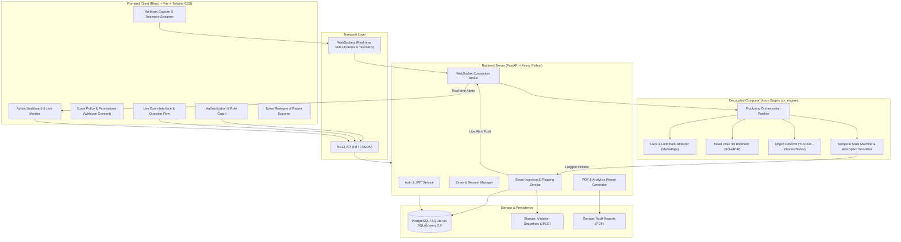
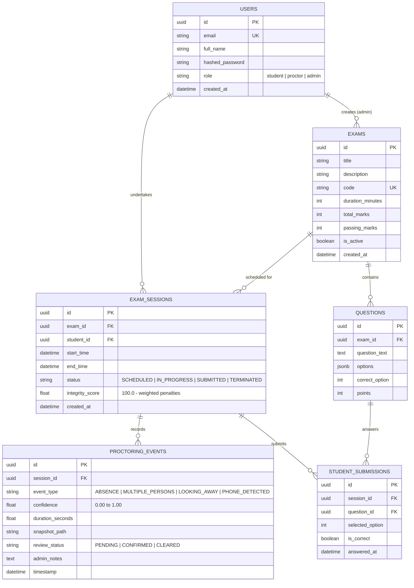
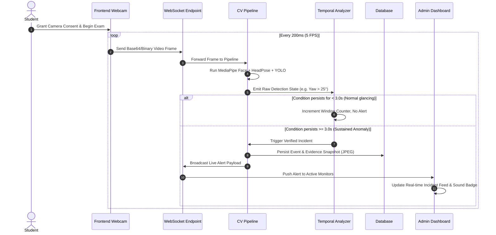

# AI-Powered Online Examination Proctoring System - Architecture Specification

## 1. System Overview

The **AI-Powered Online Exam Proctoring & Suspicious Behaviour Detection System** is an enterprise-grade EdTech solution engineered to uphold academic integrity during remote online assessments. The platform monitors examinees in real time via their webcam, executes non-intrusive computer vision inference to detect anomalous behavior, and aggregates flagged events with temporal context and confidence scores onto an administrative review dashboard.

---

## 2. High-Level System Architecture

---

## 3. Module Responsibilities & Directory Layout

### 3.1 Backend (`/backend/app`)
- **`app/core/`**: Central application settings (`config.py`), password hashing (`bcrypt`), and token lifecycle (`security.py`).
- **`app/db/`**: Database engine setup, declarative models, and schema migrations (`database.py`, `models.py`).
- **`app/schemas/`**: Strict Pydantic v2 schemas for request validation, response serialization, and type safety (`auth.py`, `exam.py`, `session.py`, `event.py`).
- **`app/api/v1/`**: Modular REST routes:
  - `auth.py`: Registration, login, JWT token issuance, user profile.
  - `exams.py`: CRUD operations for exams and question banks.
  - `sessions.py`: Student session initialization, status tracking, timekeeping, and completion.
  - `events.py`: Incident query APIs, review status transitions (`PENDING` -> `CONFIRMED` / `CLEARED`), notes.
  - `reports.py`: Comprehensive audit reports with session metrics and PDF exports.
  - `proctoring.py`: WebSocket endpoint for incoming video frame ingestion and outbound real-time alerts.
- **`app/services/`**: Encapsulated business logic separating route handlers from database and CV interactions.

### 3.2 Decoupled Computer Vision Engine (`/backend/cv_engine`)
The CV engine is completely decoupled from FastAPI to permit standalone unit testing, benchmark evaluation, or extraction into a Celery/Redis microservice.
- **`detectors/face_detector.py`**:
  - Detects examinee presence.
  - Flags **Person Absence** when face landmarks are missing.
  - Flags **Multiple Persons** when $N > 1$ faces appear in frame.
- **`detectors/head_pose.py`**:
  - Uses 468 MediaPipe 3D face mesh landmarks with OpenCV `solvePnP`.
  - Calculates continuous Euler angles: **Yaw** (horizontal), **Pitch** (vertical), **Roll** (tilt).
- **`detectors/object_detector.py`**:
  - Runs Ultralytics YOLOv8 nano/small on candidate frames.
  - Targets restricted items: `cell phone`, `laptop`, `book`.
- **`detectors/temporal_analyzer.py`**:
  - Implements **Hysteresis Thresholding & Sliding Window Counters**.
  - Prevents spurious alerts from brief eye blinks or single-frame model jitter.
  - An event is only committed if an anomaly persists across a defined duration window (e.g., $t \ge 3.0$ seconds).
- **`pipeline.py`**:
  - Receives raw frames, calls detectors, compiles telemetry metrics, and conditionally writes thumbnail snapshots when thresholds are exceeded.

### 3.3 Frontend Client (`/frontend/src`)
- **`components/common/`**: Reusable UI components (Navbar, Sidebar, Modal, Badge, StatCard, Button, Notification).
- **`components/exam/`**:
  - `WebcamMonitor`: Captures camera stream, renders status overlay, encodes frames for transmission.
  - `ExamTimer`: Synchronized countdown timer with warning alerts.
  - `QuestionCard`: Clean, distraction-free MCQ and open-question layout.
- **`components/dashboard/`**:
  - `MetricsOverview`: KPI cards (active sessions, violations, review queue).
  - `LiveProctorGrid`: Multi-student live video monitoring feeds.
  - `EventTimeline`: Chronological breakdown of infractions with confidence tags.
  - `IncidentDetailModal`: Reviewer workflow to inspect snapshot evidence and record verdict.
- **`pages/student/`**:
  - `StudentDashboard.jsx`: Enrolled exams, scheduled sessions, past scores.
  - `ExamInstructions.jsx`: Hardware checks (camera/mic test), explicit consent agreement.
  - `ExamRoom.jsx`: Full-screen secure test-taking environment.
- **`pages/admin/`**:
  - `AdminDashboard.jsx`: Global analytics, active exams, incident heatmaps.
  - `SessionReview.jsx`: Granular post-exam inspection and report download.
- **`context/`**: Global state for Auth, Live WebSocket Alerts, and Active Exam Session.

---

## 4. Database Schema (Entity-Relationship Model)

---

## 5. Event Lifecycle & Temporal Filtering Flow

To eliminate false positives, the system implements a temporal filter:

---

## 6. Privacy, Ethics & Security Principles

1. **Explicit Consent & Transparency**:
   - Students are prompted with a clear disclosure outlining what metrics are evaluated before camera activation.
   - Live visual indicator notifies the student that proctoring is active.

2. **Zero Continuous Video Archival (Data Minimization)**:
   - Full-length exam video streams are **not** saved on disk.
   - Only low-resolution episodic snapshot thumbnails associated with verified infractions ($t \ge 3.0$s) are retained for audit purposes.

3. **Human-in-the-Loop Verdicts**:
   - The AI engine does **not** auto-fail or terminate an examination.
   - Incidents are classified with status `PENDING` until a human proctor or academic administrator reviews the snapshot and either `CONFIRMS` or `CLEARS` the event.

4. **Defensible Confidence Scoring**:
   - Each infraction logs detector confidence (e.g., YOLO confidence 0.88, Head Yaw 38°), timestamp, and duration for objective review.
